# synth-struct (synthetic microstructures)

This is a code base that generates microstrcutures that are intended to be used in
mechanical simulations, such as ultrasonic, crystal plasticity, etc.

This project is licensed under the terms of the MIT license.

## Installation

### Create a virtual environment

Run the following commands to create a virtual environment  
`conda create --name synth`  
`conda activate synth`  

### Install dependencies in virtual environment

|Package              |Installation                          |Requirement                  |
|:-------------------:|:------------------------------------:|:---------------------------:|
|numpy                |`conda install numpy`                 |Required                     |
|scipy                |`conda install scipy`                 |Required                     |
|matplotlib           |`conda install matplotlib`            |Required                     |
|matplotlib-scalebar  |`conda install matplotlib-scalebar`   |Required for plotting        |
|h5py                 |`conda install h5py`                  |Required for HDF5 output     |
|pyvista              |`conda install pyvista`               |Required for meshing outputs |
|orix                 |`conda install orix=0.14.0`           |Required for plotting        |
|pybind11             |`conda install pybind11`              |Required for C++ speedup     |
|g++                  |`sudo apt install build-essential gcc`|Required for C++ speedup     |
|Eigen                |`sudo apt install libeigen3-dev`      |Required for C++ speedup     |
|pytest               |`conda install pytest`                |Required for tests           |

For g++ and Eigen, it is preferable to install them outside of the conda virtual environment

### Clone repository

Clone the repository from Github

### Make output directory

`cd synth-struct`  
`mkdir output`

### Install the project

When in project root run:  
`pip install -e .`

### Testing Installation

Once installed, run the following command to run the tests  
`pytest tests/`  

### Installation notes

The first time running an example, the code may take slightly longer than normal due to the program compiling on first run

## Examples

Below are some examples of the microstructures that can be generated using synth-struct.

### Basic Microstructure Types

The included microstructure generator classes are: Voronoi (2D/3D), Ellipsoidal (2D/3D), Mixed Equiaxed/Ellipsoidal (2D/3D), and Columnar (3D only).

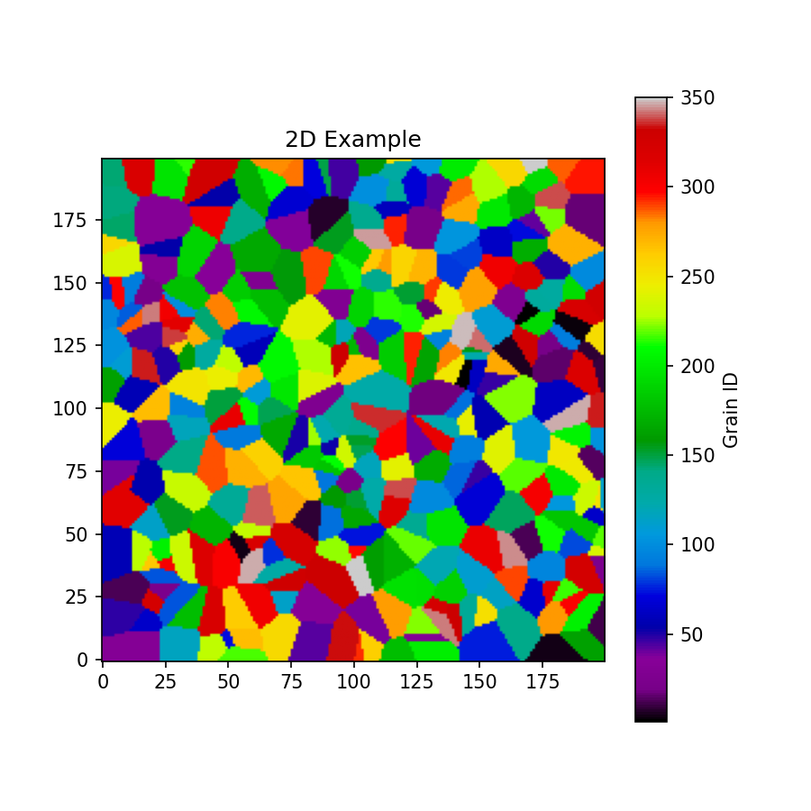  
*2D Example of Voronoi microstructure generation.*

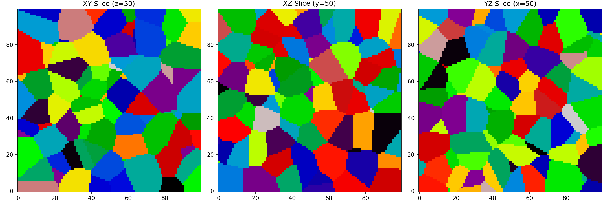  
*3D Example of Voronoi microstructure generation.*

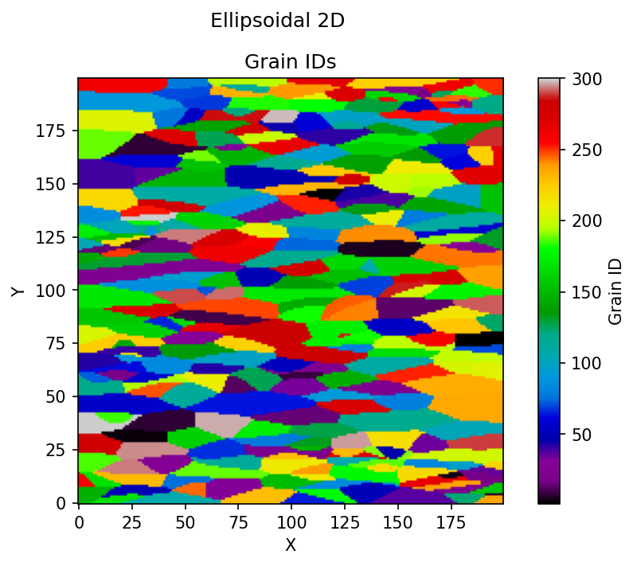
*2D Example of Ellipsoidal microstructure generation.*

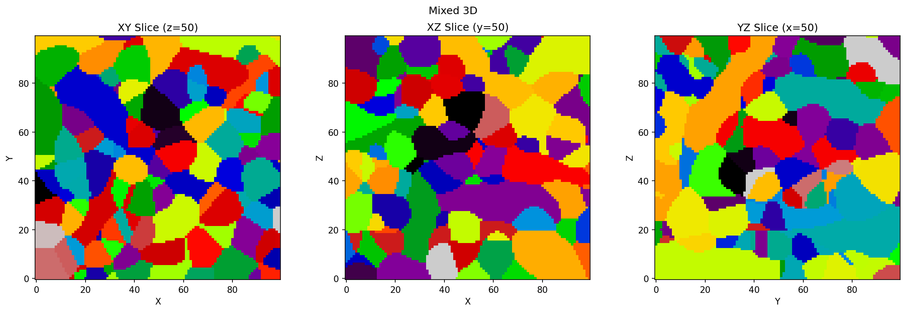
*3D Example of Mixed Ellipsoidal/Equiaxed microstructure generation.*

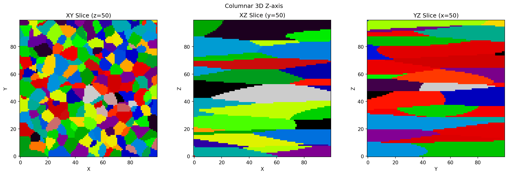
*3D Example of Columnar microstructure generation.*

### Texture Generation

You can generate or assign textures to each grain. You can either generate a random texture or you can generate various common textures for Cubic and Hexagonal systems as shown below. You can also create your own custom textures. With each texture generation you can also add in some error to create more realistic textures.

The built-in textures for Cubic systems are: Cube, Goss, Brass, Copper, S, P, Rotated Cube, and Rotated Goss.

The built-in textures for Hexagonal systems are: Basal, Prismatic, and Pyramidal

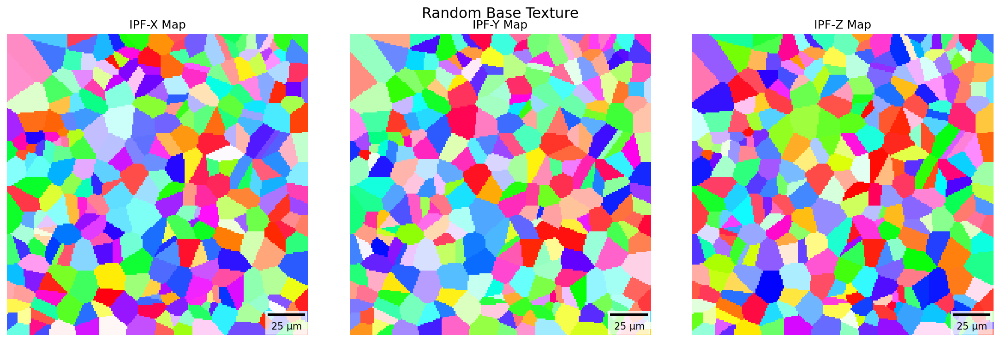
*Random Texture*

#### Cubic Textures

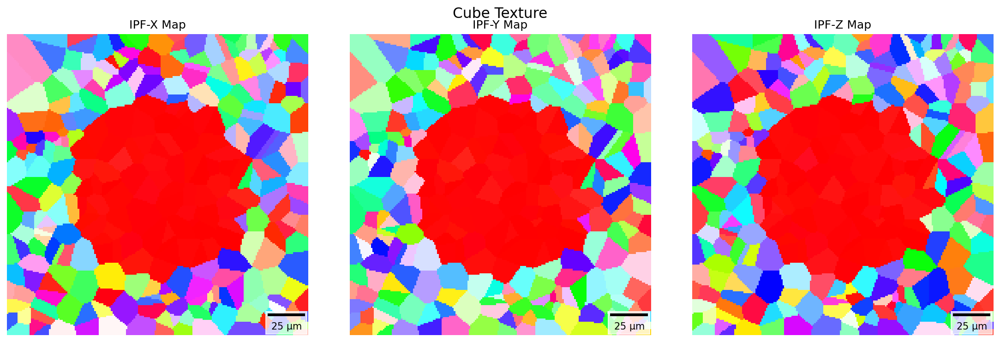
*Cube Texture*

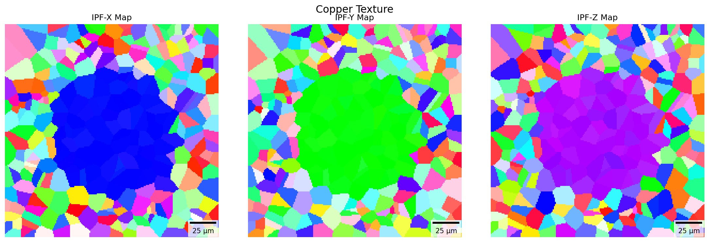
*Copper Texture*

<!-- 
#### Hexagonal Textures

*Basal Texture*

*Pyramidal*
-->

#### Custom Textures

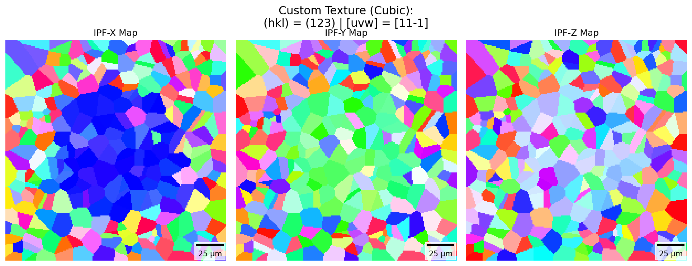
*Custom Cubic texture*

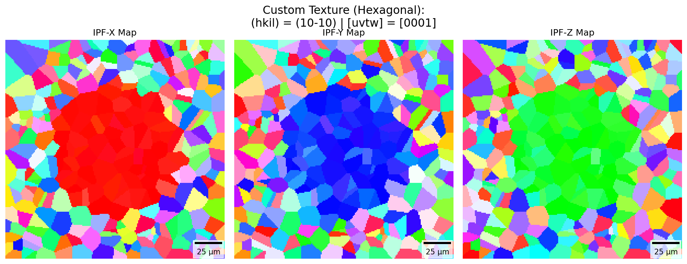
*Custom Hexagonal texture*

### Masks

To be able to assign textures to specific parts of a microstructure, masks can be used. There are several implemented mask shapes: Box, Sphere, and Cylinder. You can also create your own custom masks.

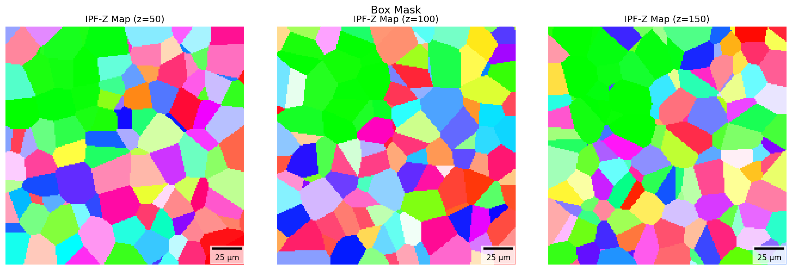
*Box mask*

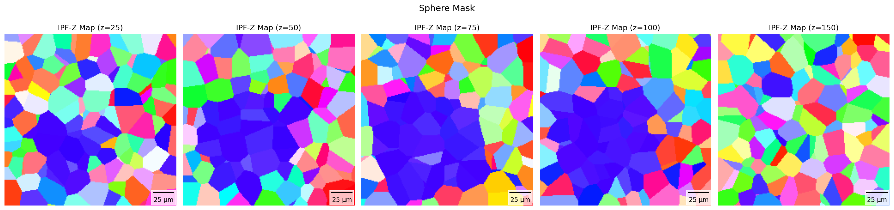
*Sphere mask*

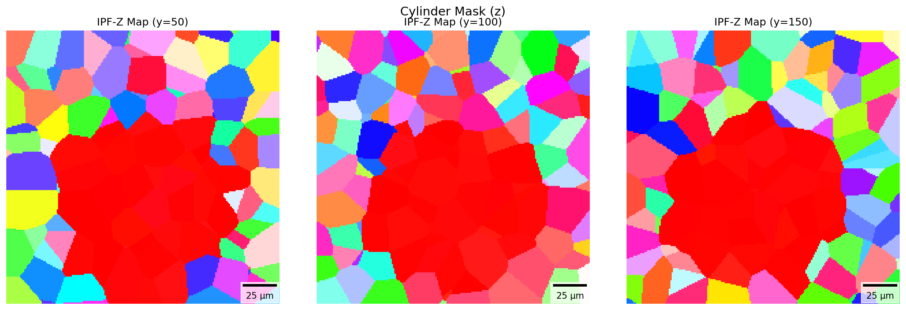
*Cylinder mask*

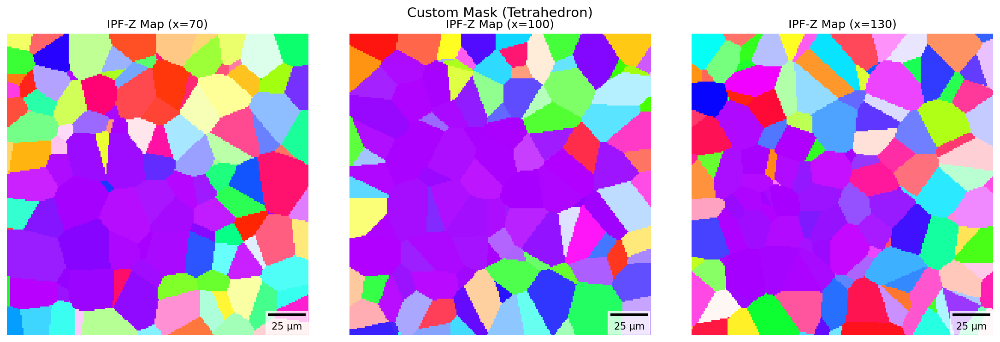
*Custom tetrahedron mask*

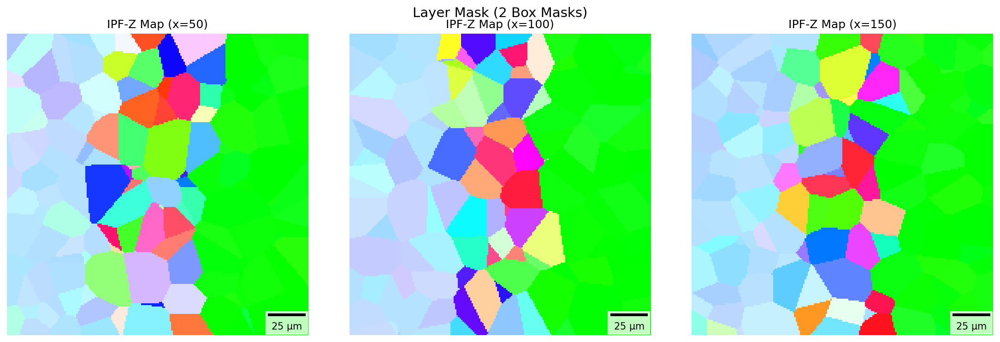
*Custom layered mask*

## Citation

> D. Rowenhorst, A. D. Rollett, G. S. Rohrer, M. Groeber, M. Jackson,  
> P. J. Konijnenberg, and M. De Graef, 2015
> *Modelling and Simulation in Materials Science and Engineering*
> DOI: [10.1088/0965-0393/23/8/083501](https://doi.org/10.1088/0965-0393/23/8/083501)

## Other Open-Souce Projects

synth-struct incorporates orix for EBSD/texture/orientation plotting.

- [https://github.com/pyxem/orix](https://github.com/pyxem/orix)
